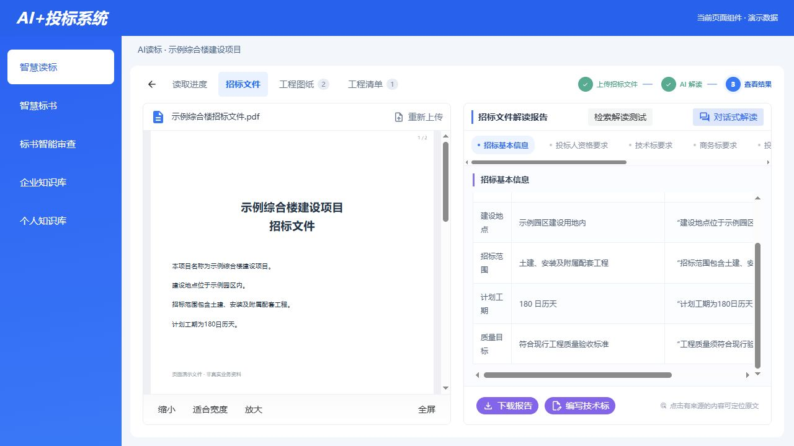
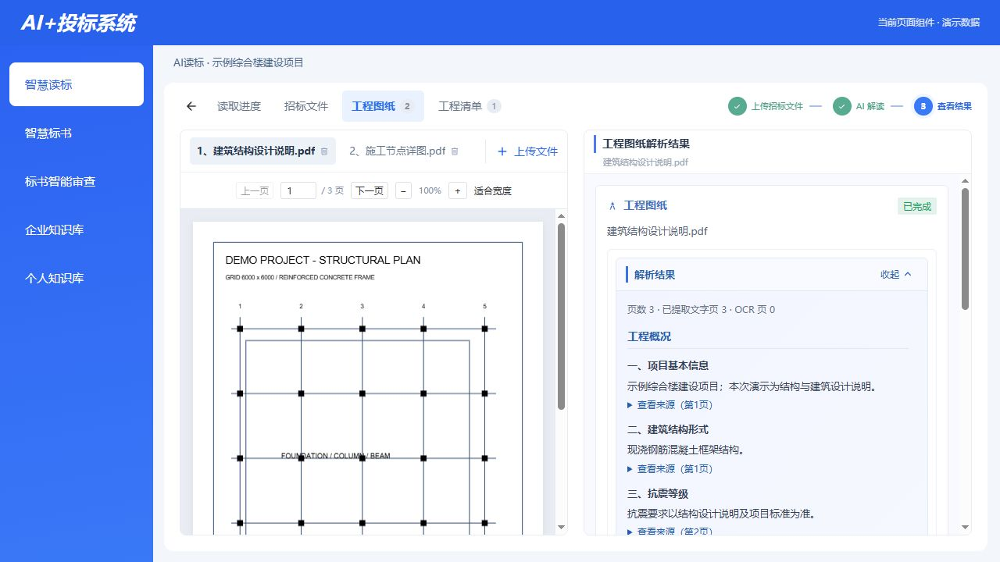
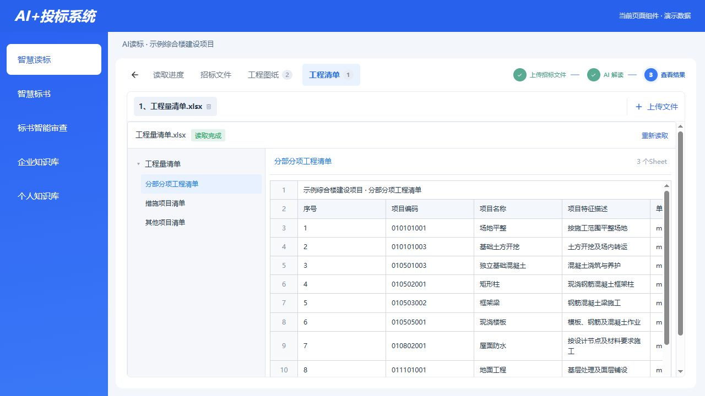
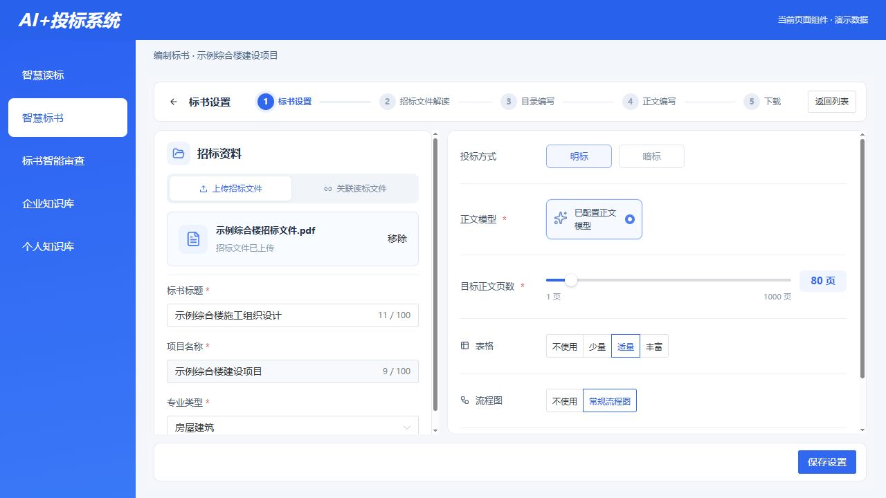
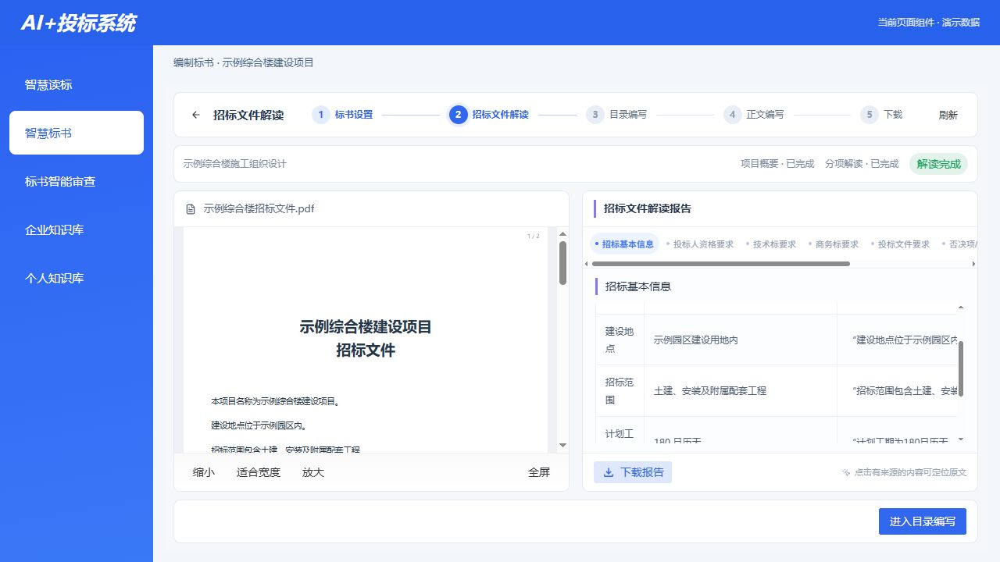
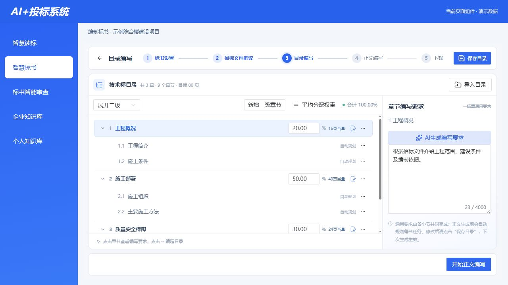
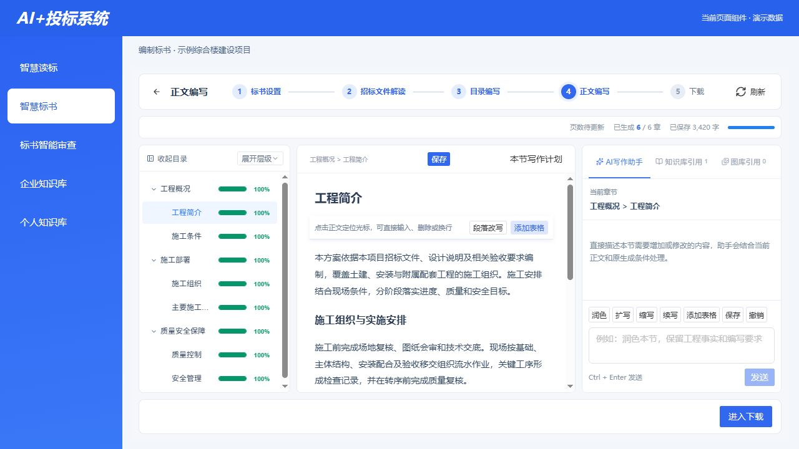
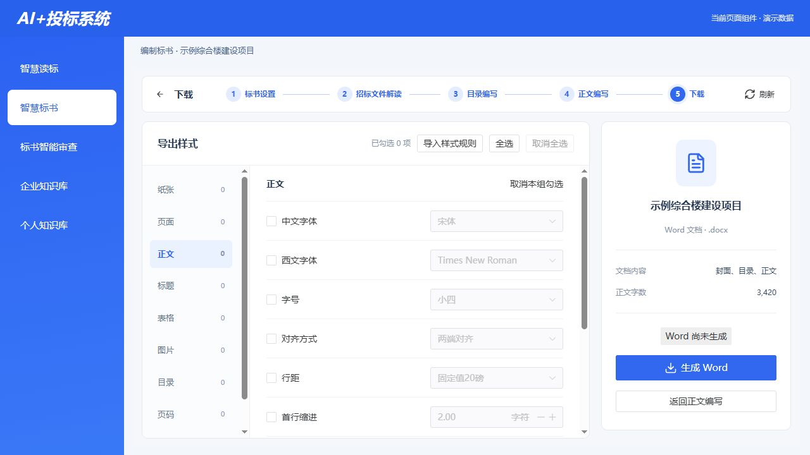

做这个项目时，我一直在想：一个人拿到一大包项目资料后，怎样才能少一点手忙脚乱？

里面可能有几十页甚至更长的招标文件，有工程图纸，也有装着许多工作表的 Excel 清单。准备投标的人要从中找要求、核对条件、整理方案，还要留意哪些地方不能漏。资料之间经常需要来回对照，写着写着，又得翻回原文件确认一句话。

我做的 **AI 投标平台**，就围绕这些工作展开：帮助使用者先把资料看明白，再把方案写出来、改好，最后整理成可以交付的文件。

这篇文章想带你看看这个项目，也聊聊我在做它时的一些选择。即使你没有接触过招投标，或者并不写代码，也可以顺着下面的过程了解它。

*文中的界面来自当前版本。为了方便展示，截图使用了演示项目和示例资料。*

## 先说说，它是给谁用的

你可以把招投标理解为这样一个过程：一方把“我要做什么、对合作方有什么要求”写清楚，另一方根据这些要求，准备自己的方案和材料。

这个项目主要面向工程投标相关的工作人员。它把阅读招标文件、查看工程资料、编写技术方案和辅助检查放在一起，让前面整理过的内容能接着用于后面的工作。

比如，招标文件里提出了施工质量要求，读标时先把它找出来，编写方案时就能带着这条要求安排对应内容，检查时再回来核对有没有回应。文件之间有了联系，使用者也更容易知道自己做到哪一步了。

## 第一步，先把厚厚的文件读明白

我把这一部分叫作“AI 读标”。说得直白一点，就是帮使用者把招标文件里的重要事情整理出来。

上传文件后，系统会按不同主题展示结果，例如项目的基本情况、投标资格、技术要求、商务要求，以及可能导致投标无效的条款。使用者可以先看全貌，再去细看与自己有关的部分。

<figure style="width:100%">

</figure>

*左边放原文件，右边放整理后的内容，方便边看边核对。*

这里有一个我很在意的细节：**看到一条结论时，应该能回到文件里看看它的依据。**

所以我保留了原文对照和来源定位。读到某项要求有疑问，可以点击带出处的内容，回到对应的原文附近核对。需要继续追问时，也可以打开对话面板，围绕当前文件提问。

举个例子，使用者可能想确认：“这份文件对项目人员有什么要求？”系统可以辅助整理相关内容，但最终仍然能沿着引用回到文件里确认适用条件。这样，读完报告之后，手里还有可以检查的依据。

文件较长时，处理需要一点时间。我也把等待过程放进了设计里：页面会告诉使用者当前的进度，可以先离开，稍后再回来查看结果，不必一直守着一个转圈的页面。

## 图纸和清单，也应该有合适的阅读方式

工程项目的资料有不同的样子。文字适合按条款阅读，图纸需要放大、翻页和对照，清单则更适合保留表格的样子。

因此，在最新的读标页面里，我给工程图纸和工程清单分别安排了入口。它们和招标文件属于同一个项目，查看时又各有自己的空间。

### 工程图纸：一边看图，一边了解工程情况

进入工程图纸页面后，可以在不同文件之间切换，也可以翻页、缩放，查看图上的具体位置。旁边会整理与工程有关的信息，例如建筑结构、防水、防火和主要施工内容。

<figure style="width:100%">

</figure>

*把图纸和整理结果放在一起，减少在两个窗口之间来回切换。*

我希望它能帮助使用者更快找到需要注意的地方。对于图纸里没有提供、或者暂时没有读清楚的信息，页面会保留提示，方便继续查证。需要核对时，也可以展开相关内容的出处。

图纸可以分批补充，处理过程和结果都跟着各自的文件走。这样，后来新增了一份图，也能知道它现在处理到了哪里。

### 工程清单：先把表格完整地摆出来

工程清单通常用来列明需要做哪些工作、涉及什么项目，以及相应的数量。它经常是一份带着多个工作表的 Excel 文件，查看时很容易在不同表之间迷路。

这部分我选择保留大家熟悉的表格阅读方式：先选文件，再从左侧选择工作表，右侧查看内容。

<figure style="width:100%">

</figure>

*一份文件里的不同工作表集中展示，标题、行号和合并区域也能一起看到。*

使用者可以查看有多少张表、当前表有多少行和列，遇到宽表时横向滚动，内容较多时分页浏览。资料更新后，也有重新读取的入口。

目前，这部分主要解决的是“把清单读全、看清楚、方便对照”。表里的内容仍需要结合实际业务判断，读取完成也不代表已经完成了计价或造价分析。

## 接下来，把读懂的要求变成一份标书

看完资料，后面还有一件大事：把自己的实施方案写出来。

工程投标中常说的“技术标”，可以理解为投标文件里说明准备怎样组织工作、采用什么方法、如何保障质量和安全的那一部分。它需要围绕当前项目展开，也要回应招标文件的要求。

我把编制标书的页面重新整理成了五步：**准备资料 → 核对要求 → 安排目录 → 编写正文 → 导出文件。** 页面上的步骤导航会一直保留，方便使用者知道自己在哪里，也能回到前面的环节调整。

### 先准备好这份标书要用的资料

开始时，可以上传新的招标文件，也可以选择已经读过的项目。后者能继续使用前面整理的结果，减少重复准备。

接着填写项目与标书信息，选择专业、期望的篇幅，以及表格、图片等偏好。如果项目有匿名编写要求，也在这里设置。

<figure style="width:100%">

</figure>

*先把“写哪一个项目、用哪些资料、希望写成什么样”说明白。*

这里我把资料和编写偏好分开放，尽量让同一类选择待在一起。准备好之后，再进入后面的步骤。

### 动笔之前，再确认一次对方的要求

第二步会把招标文件和解读结果放回使用者面前。前面读过的内容可以接着用，新上传的文件则先完成解读。

<figure style="width:100%">

</figure>

*开始写作前，再把项目要求放在眼前看一遍。*

我保留这一步，是希望使用者有机会认真核对：当前是不是选对了文件，重要要求有没有理解清楚。后面要写的内容，应该围绕这份项目资料展开。

### 先有一份自己的目录，再慢慢展开

长文档如果一上来就写正文，很容易写散。目录在这里更像一份写作计划：哪些内容要讲，哪些章节更重要，每一章准备写到什么程度。

可以从已有模板开始，再调整成当前项目需要的结构。导入后，它就是这份标书自己的目录，继续修改不会影响原来的公共模板。

<figure style="width:100%">

</figure>

*先搭好结构，再告诉系统每一章需要重点写什么。*

使用者可以增减章节、修改名称、补充要求，也可以给重要章节安排更多篇幅。这样，后面的生成有了方向，人工修改时也更容易找到对应的位置。

### 让 AI 起草，也给人留足修改的空间

正文页面是我花了不少心思整理的一部分。左边是目录，中间是正文，右边是 AI 写作助手和参考资料。选中一节后，相关内容就放在同一处，尽量减少反复找窗口的操作。

<figure style="width:100%">

</figure>

*左边选章节，中间认真写，右边需要帮忙时再打开。*

系统会结合项目要求、目录安排和可用的参考材料，分章节形成初稿。使用者可以继续修改文字、补充内容、调整表格，也可以请助手润色、扩写，或者把某一段重新组织一下。

比如，一段内容把事情说清楚了，但表述有些松散，可以先让助手给出修改建议，再决定哪些值得采用。对于自己的判断和项目经验，使用者也可以直接写进正文。

我希望这个过程保留人的主动权。参考内容能查看来源，较大的替换会先确认，AI 给出的修改也可以先看、再决定是否使用。写到一半需要离开，回来还应该接得上自己的工作。

### 最后，拿到一份与修改结果对应的文件

写完正文，还要把它整理成便于交付的 Word 文件。字体、段落、目录和页码这些细节看起来琐碎，却会直接影响最后的阅读体验。

<figure style="width:100%">

</figure>

*正文改好之后，再统一整理样式，生成可以继续使用的 Word 文件。*

我把下载安排成独立的一步，让使用者能集中处理这些收尾工作。修改正文或调整样式后，再生成相应的文件，尽量避免“页面上已经改了，下载下来却还是旧内容”的困扰。

期望的页数可以帮助安排篇幅，但实际分页还会受到图片、表格和字体等因素影响。页面会把文件的状态和相关提示保留下来，方便使用者继续调整。

## 写完之后，还要认真检查

除了阅读和编写，平台也有辅助检查功能，用来核对投标内容是否回应了要求、格式是否符合设置，以及是否存在需要进一步关注的内容。

这部分的作用，是把值得留意的地方集中找出来，方便使用者回到文件里复核。涉及项目条件、承诺和重要判断的内容，仍需要由具体负责的人确认。

我觉得这也决定了 AI 在这个项目里的位置：它可以帮忙整理、起草和提醒，使用者则始终能看到依据，保留修改和判断的余地。

## 以前整理过的经验，下次还能接着用

投标工作里有很多值得积累的东西：常用的施工方法、以往方案的组织方式、图文材料，以及整理好的目录和样式。

所以项目里也安排了资料库、图库和模板。这些内容可以在有权限的范围内查找、参考，再结合当前项目修改，让过去做过的整理有机会继续发挥作用。

复用时，我更在意内容是否适合这一次的项目。能看到参考来自哪里，能读到相关内容，再决定要不要用，往往比直接塞进一大段文字更有帮助。

## 我在这个项目里，最想做好哪些事

我的工作主要放在把前后的业务流程接起来：让文件上传后有地方查看，让读到的要求能继续用于写作，让正文改好后能生成对应的交付文件。同时，也不断调整页面，让这些过程更容易理解和操作。

做着做着，我越来越在意一些看起来很小的事情。

**使用者应该知道下一步做什么。** 所以我把编标拆成清楚的步骤，让资料、要求、目录和正文各有自己的位置。

**等待时，也应该有个交代。** 文件处理和内容生成需要时间，页面要能说明进展，出了问题也要有可以继续处理的入口。

**认真改过的内容，应该留得住。** 无论是切换章节、重新打开页面，还是再次生成文件，我都把保护已有修改、分清当前内容放在很靠前的位置。

这些细节不一定在第一眼最显眼，但它们会影响一个人能不能放心地把工作放进系统里。

## 这个项目带给我的一点思考

做 AI 应用，很容易先被“能生成什么”吸引。真正把它放进一段工作流程后，我才会不断回头想：生成之前，资料准备好了吗？生成之后，人要怎么检查、怎么修改？如果暂时没有做完，下次还能不能顺着继续？

AI 投标平台让我有机会把这些问题一点点落到页面和功能里。现在，它已经串起了阅读资料、编写方案、辅助检查和文件交付的主要过程；后面还有许多值得继续打磨的地方，例如让参考资料更贴合当前章节，让报告里的依据更容易核对。

我想继续做的，是让需要认真读、认真写的人，少花一点时间来回找资料，多留一点精力给项目本身。

如果你也做开发，这里补充一点技术信息

前端主要使用 Vue 3、TypeScript 和 Naive UI，正文编辑采用 Tiptap；后端基于 Java、Spring Boot 和 RuoYi-Vue-Plus，负责项目资料、权限、处理任务以及文件生成。

AI 用于文件解读、写作与修改建议，文档和表格处理、进度记录、保存与导出则由相应的业务功能配合完成。对我来说，开发中花精力较多的部分，是让这些能力在同一份项目资料下协同工作，并处理等待、失败、再次进入页面和内容保存等实际情况。

