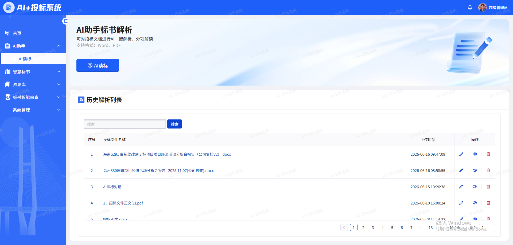
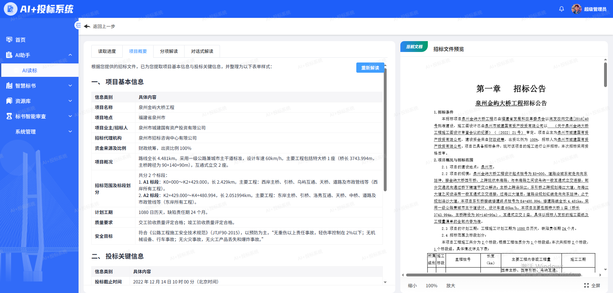
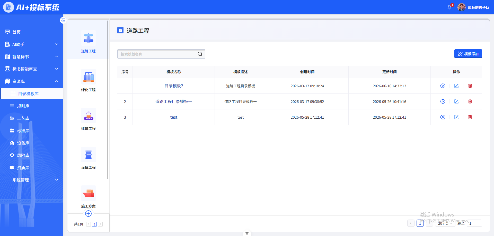
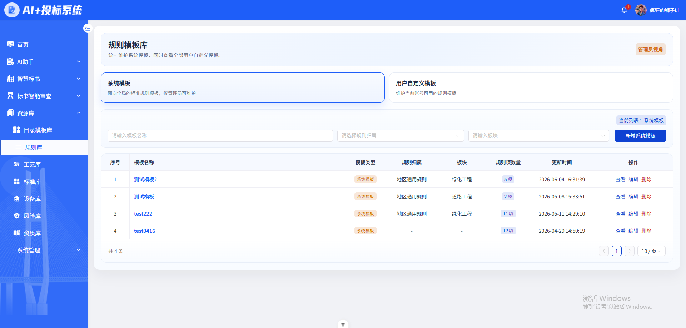
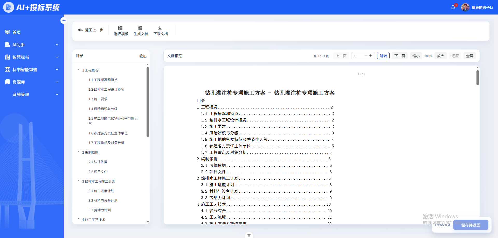

## 项目背景

这是一个围绕招投标业务搭建的 AI 辅助平台，核心目标不是做一个普通的管理后台，而是把 **标书上传、读标解析、纪律性审查、响应性检查、模板沉淀、方案生成和在线编辑** 串成一条完整链路，帮助业务人员减少重复性整理和人工比对工作。

<figure style="width:75%">

</figure>

整套系统主要服务于以下几个真实业务场景：

- 招标文件、投标文件上传后，需要快速完成文本提取、预览和结构化处理。
- 面对多家投标单位的技术标，需要做纪律性分析、响应性检查和内容样式校验。
- 历史优质方案、目录模板、样式规则需要沉淀到资源库，方便后续复用。
- 在新项目开始时，希望根据招标文件内容、方案目录和模板资源快速生成一份技术方案初稿。
- 生成后的文档还需要支持在线预览、改写、保存和再次下载，真正进入可交付状态。

## 我对这个项目的理解

这套系统围绕 **读懂招标文件、核对投标内容、沉淀可复用资料、编制技术标书** 四个环节展开。读标产出的项目概要和分项要求，会继续成为编标时的事实依据；目录、知识资料、人工修改和导出版本则把后续工作连接起来。

2026 年 11 月，我结合当前前后端实现，重新梳理了 AI 读标与编制标书两部分。下面记录的是现有页面及其对应的处理流程，早期截图保留作项目迭代留档。

## AI 读标：从文件导入到可核对的阅读工作台

读标的使用过程可以分成三步：**上传招标文件 → AI 解读 → 查看结果**。用户从项目列表进入任务，在同一个工作台里查看原文件、项目概要、分项报告，以及后续补充的工程资料。

### 项目与任务一起管理

招标文件入口支持上传 DOCX 和 PDF。文件进入 OSS 后，后端创建与项目、用户关联的读标任务，先进行文档转换，再生成项目概要和分项解读。转换结果包含分页预览所需的 HTML、页码和段落锚点，报告和原文预览使用同一份文档来源。

项目列表展示文件名称、处理状态和资料情况，支持编辑项目名与文件显示名、查看结果和删除记录。普通读标任务在当前转换和解读结束后，还可以重新上传招标文件，重新生成对应的概要与分项结果。对于编标关联的文件，更换来源会回到标书设置处理，保持读标与编标的来源一致。

处理过程由后台任务推进。前端打开页面时订阅概要和分项进度，通过执行批次与游标接收增量内容；实时连接异常时可以退回进度查询并重连。关闭工作台会停止当前页面的订阅，后台解读仍会继续，再次进入时可以恢复查看。

这个设计解决了一个很具体的问题：长文档解析和模型生成需要时间，用户应该能够离开页面继续工作，并在回来时看到真实的阶段、已完成的内容或失败原因。

### 页面重构：把原文、报告和对话放在各自合适的位置

重构后的工作台按资料类型提供 **招标文件、工程图纸、工程清单** 等入口。招标文件区域采用原文与解读结果并排的布局，报告区域再按业务主题切换，减少在长报告里反复滚动查找的操作。

目前报告导航包含八类内容：

- 招标基本信息。
- 投标人资格要求。
- 技术标要求。
- 商务标要求。
- 投标文件要求。
- 否决项 / 废标项。
- 其他重要信息。
- 专业策略建议。

前端通过 `report-sections.ts` 对已有报告内容分组，保留表格、引用和来源锚点。表格展示也做了单独处理：业务表头与正文列对齐，段落 ID 等内部定位字段用于交互，不混进用户阅读的业务列。

对话读标作为按需打开的独立面板，沿用当前任务与文件上下文。用户可以先看概要、核对某个栏目，再带着具体问题继续追问，阅读位置和报告内容不需要随对话反复切换。

<figure style="width:72%">

</figure>

*上图为早期读标界面。后续重构重点是资料切换、栏目导航、原文定位和独立对话面板。*

### 原文定位，让解读结论可以回到文件里核对

读标报告中的条款需要有可核对的出处。用户点击带来源的内容时，前端会优先结合页码和段落 ID 查找原文，再按可用信息尝试段落或字面引用定位；同一条结果涉及多个来源时，可以继续切换核对。

这部分由报告表格的来源解析与文档预览组件共同完成。预览组件根据转换清单加载相应页面，滚动到目标位置并突出相关内容。无法定位时给出反馈，保留人工核对的入口。

对话也绑定到当前读标任务。后台按当前文档转换快照分批读取文字，核对原文摘录后汇总证据，再流式输出回答和已核实的出处。问题较长、来源读取失败或引用核验失败时，有对应的限制、重试与错误处理，避免把一次没有完成的核查显示成完整结论。

### 工程图纸与清单采用不同的阅读方式

工程资料被纳入同一项目，但各自保留合适的处理与展示方式。

| 资料类型 | 处理与页面展示 |
| --- | --- |
| 招标文件 | DOCX / PDF 转换、项目概要、栏目解读、原文定位与任务内对话 |
| 工程图纸 | PDF 逐页预览、后台图纸解析与解读、进度及失败重试 |
| 工程清单 | 读取 Excel 全部工作表，按 Sheet 展示原始单元格、行列及合并区域 |

其中，当前读标清单的原表读取使用 Apache POI，保留单元格显示值，公式使用文件中的缓存结果。这条原表读取流程不调用模型生成清单结论，页面也不会把“已读取工作表”包装成“已完成造价分析”。

后台职责也有明确区分：业务入口负责鉴权、项目和任务状态，`doc_convert` 承担招标文件转换，工程图纸与清单的初次处理通过各自任务交给 `ai_check`。前端只观察这些任务并展示结果，切换文件时校验当前任务上下文，避免旧请求的结果覆盖新打开的资料。

概要和分项报告完成后，还可以导出 Word 解读报告。读标最终沉淀的是与项目、文件和任务关联的一组结果，既能回看、核对，也能继续提供给编标流程使用。

## AI 清标 / 审查

这一块是项目里最明确的业务主线，围绕 `投标信息`、`纪律性分析`、`响应性检查`、`内容样式检查` 展开。

- 维护标段信息和投标单位数据。
- 支持批量生成标段关联数据和投标关联数据。
- 支持上传投标文件、查询任务状态、分页预览 Word 转 HTML 的内容。
- 支持纪律性分析和响应性检查的启动、结果查询、详情查看、异步任务追踪。
- 支持样式检查规则、通用规则和自定义规则的维护。
- 支持检查后的一键改写、段落更新、结果回写和文档导出。

这部分不仅有常规 CRUD，还加入了异步任务、防重复发起、并发测试入口、OSS 直传、RabbitMQ、文档转换等能力，说明系统已经开始从“功能可用”向“业务可落地”推进。

## 模板资源库

这一块由资源模板库、方案类型、目录模板、文档模板共同组成，是整个系统后续复用能力的基础。

<figure style="width:68%">

</figure>
<figure style="width:68%">

</figure>

- 可维护方案类型。
- 可维护模板分类。
- 可上传和管理资源库文档。
- 模板文档除了文件本身，还支持保存结构化的模板内容。
- 目录模板和普通模板是分开的，生成方案时会有筛选逻辑。

我比较看重这一块，因为它决定了系统是不是一次性工具。只有把目录、模板、样式规则和方案类型沉淀下来，后续 AI 生成才会越来越像“企业自己的能力”，而不是每次重新从零开始。

## 编制标书：从读标结果到可编辑的技术标

编制标书把招标要求、目录结构、参考资料和人工编辑组织成一条连续流程。当前前端将它拆成五个独立步骤，每一步有自己的页面、数据与进入条件：

| 步骤 | 用户完成的工作 | 向下一步提供的内容 |
| --- | --- | --- |
| 标书设置 | 确定资料来源、专业、模型与编制偏好 | 当前标书的输入与规则 |
| 招标文件解读 | 查看概要、分项要求并核对原文 | 与当前文件关联的项目事实 |
| 目录编写 | 编辑目录副本、权重与章节要求 | 可保存的目录结构与篇幅分配 |
| 正文编写 | 分章生成、查看参考、人工修改 | 带版本的可编辑正文 |
| 下载 | 选择样式并生成 Word | 对应保存版本的交付文件 |

步骤条由共享组件维护，用户可以回到已具备条件的步骤修改。来源已失效、目录未保存或正文尚未就绪等情况，会在页面和后端分别检查，避免只依靠按钮禁用来控制流程。

<figure style="width:76%">

</figure>

*上图保留早期方案编制界面，当前实现已进一步拆分为上述五步。*

### 第一步：标书设置，先确定生成的输入

资料来源有两种：上传新的招标文件，或关联已有的读标项目。两种来源互斥，保存时只提交当前选中的来源；切换选项时保留页面中的草稿，减少重复填写。

这一页同时设置标书标题、项目名称、专业类型、明标 / 暗标、正文模型、目标正文页数，以及表格、流程图和图片等编制偏好。布局上把资料与基础信息放在一侧，把编制规则集中到另一侧，模型采用明确的选项展示，目标页数通过滑块与数值反馈配合调整。

这些设置会参与后续任务的输入快照。暗标选项用于约束生成过程，最终内容和格式仍需结合具体招标文件核对；目标页数用于分配写作篇幅，实际分页还受字体、段落、图表和版式影响。

### 第二步：复用读标成果，保持文件与报告对应

关联已有读标项目时，编标复用其项目概要、分项报告和原文件；新上传时，则先完成文档转换，再生成当前来源的解读结果。第二步复用了读标的原文预览、八类栏目、来源定位和报告下载能力。

编标在这里聚焦于核对招标要求，当前页面没有接入读标工作台的对话面板。普通读标中的任务问答仍保留在读标入口，两个页面按各自的工作目标组织功能。

新上传来源的概要和分项解读完成后，会登记到读标列表，方便继续查看与管理。文件来源、执行代次和用户归属随任务绑定，重复保存或刷新时复用符合条件的任务。若关联来源已删除，页面会提示更换有效来源，并阻止继续基于旧来源发起生成；已完成正文的编辑和下载则有独立的保留规则。

### 第三步：目录编写，保存当前标书自己的结构

目录页面支持按专业选择模板，将模板内容导入当前标书的独立副本，再进行章节增删、名称调整、结构编辑和要求补充。后续修改作用于这份标书，不会直接修改公共模板。

页面采用目录与章节设置分区展示的方式：一侧选章节、看层级，另一侧编辑该章要求。模板通过带范围、搜索和分页的弹窗选择，避免把模板浏览、目录编辑和章节配置挤在同一区域。

一级章权重需要合计为 100%，用于将目标篇幅分配到各章。章节要求既可以人工补充，也有根据当前项目事实生成要求草稿的入口；草稿经用户确认保存后，才成为当前目录的一部分。开始正文生成前，页面会检查未保存的修改和生成条件。

### 第四步：正文编写，按章节组织生成、引用和修改

正文工作台采用三栏结构：**左侧章节目录，中间正文编辑，右侧 AI 写作助手与知识库、图库引用**。用户始终围绕当前选中的章节工作，可以看到章节状态、已有正文、写作计划和相关参考资料。

后台会先冻结项目事实、目录、模型及编制设置，为末级小节规划写作任务，明确范围、展开深度、所需依据和与相邻章节的边界。写作计划分批保存后，再按章节检索参考资料、生成正文，减少不同小节重复堆叠同一套通用内容。

参考资料来自工艺工法、历史标书和图库。检索会结合专业、章节主题、标签及当前用户可访问的资料范围，保存候选、来源和使用情况。页面把知识库引用与图库引用分开展示，用户可以查看参考正文、使用参考内容改写当前节，或在确认后将参考原文替换到当前节；图库素材也有受控插入入口。

正文编辑使用 Tiptap，覆盖段落、标题、列表、表格、图片和流程图等内容块。生成结果可以继续人工修改，并通过自动保存和手动保存记录章节版本。保存请求携带预期版本，遇到并发修改或旧页面状态时返回冲突提示，防止悄悄覆盖较新的内容。

AI 写作助手在启用后，围绕当前章节及最新编辑内容提供候选修改，支持预览、确认应用和撤销。局部文字也可以通过段落改写入口处理，先查看候选、调整文字，再应用到目标段落或表格单元格。整节参考替换与局部改写有各自的确认和版本校验，操作范围保持可见。

生成任务持久化在服务端，由专门的有界执行器和租约机制推进。页面离开后可以重新读取最新任务；某一章节失败时，其他已完成章节仍可阅读，并提供章节重试、规划重试或导出重试等入口。前端还会隔离不同任务与章节的请求，防止切换后出现正文或引用串位。

### 第五步：下载，让导出文件对应已保存的正文

下载被拆成独立页面，集中设置纸张、字体、段落等受支持的导出样式，也可以导入有权使用的样式规则，再逐项勾选调整。

后端按已保存的正文版本冻结内容和样式，生成包含封面、目录与正文的 Word 文件。相同内容版本与样式可以复用已有导出任务；修改正文或导出样式后，对应关系也会重新核对，避免用户编辑了新版正文却下载到旧文件。

篇幅控制与实际文件生成分别记录。目标页数存在偏差时，保留实际页数和提示；文件生成失败则走独立的重试流程。这样用户既能拿到已完成的正文，也能明确知道最终 Word 的状态。

### 这次前端重构解决了哪些问题

这一轮重构把复杂操作拆成可以回访的工作步骤，并把“当前编辑的是谁、依据来自哪里、保存到了哪个版本”持续展示出来。

- **输入更明确**：上传与关联来源分开校验，专业、模型和编制规则集中设置。
- **阅读更连贯**：原文与报告并排，栏目快速切换，条款可以回到原文核对。
- **编辑更聚焦**：目录、正文和引用各有位置，参考替换及 AI 修改先确认再应用。
- **状态更可信**：页面状态来自后台任务，离开、重进和失败重试都有对应处理。
- **交付可对应**：正文保存版本、导出样式与 Word 产物绑定，减少旧结果误用。

对我来说，编制标书最有价值的部分，是把招标要求、参考资料、模型写作和人工判断放进同一条可核对、可继续编辑的工作流。

## 我从代码里总结出的业务需求

结合前后端实现，我认为这个项目的业务需求大致可以总结成下面几类。

### 文档处理需求

- 需要统一管理招标文件、投标文件和生成文档。
- 需要支持 Word、PDF 等文件的上传、存储、解析和预览。
- 需要把非结构化文档内容转换成可检索、可分析、可再次利用的数据。

### 审查提效需求

- 需要减少多家投标文件横向比对的人工成本。
- 需要用规则和 AI 结合的方式做纪律性分析、响应性检查和样式校验。
- 需要将检查结果结构化展示，并能定位到具体问题内容。
- 需要对审查任务进行异步化处理，避免长时间阻塞页面操作。

### 知识沉淀需求

- 需要把历史优质方案和目录标准化沉淀到模板库。
- 需要让不同专业类型对应不同的目录模板和方案模板。
- 需要支持规则库和模板库的持续维护，而不是写死在代码里。

### 内容生成需求

- 需要复用招标解读事实，结合目录要求、工艺工法、历史标书与图库，按章节生成技术标初稿。
- 需要支持生成过程中的进度查询、失败重试和在线预览。
- 需要在生成后继续人工编辑，并把 AI 改写融入具体段落优化流程。

## 这个项目里做了哪些内容

如果从“做了什么”来总结，我会把它概括成下面几部分。

### 后端侧

- 基于 RuoYi-Vue-Plus 做了多模块扩展，包含审查模块、聊天模型模块、文件解析模块、模板资源模块。
- 设计了投标信息、方案、规则、结果、任务、模板、目录等核心数据模型。
- 实现了文件上传、OSS 直传、文档下载、Word 转 HTML 预览等基础能力。
- 落地了纪律性分析、响应性检查、内容样式校验等核心接口。
- 接入 LLM 能力，用于方案生成、文本改写和 AI 聊天。
- 实现了读标概要 / 分项进度、任务内问答、原文来源核对，以及编标任务的快照、章节规划、素材检索与失败恢复。
- 实现了章节编辑版本校验和带样式快照的 Word 导出，生成内容、人工修改与最终交付文件能够对应。
- 补充了异步任务、并发控制、任务状态查询等工程化处理。

### 前端侧

- 基于 Vue 3 + TypeScript + Vite + Naive UI 搭建了现代化后台界面。
- 实现了 AI 清标列表、审查详情、规则配置、结果查看等页面。
- 将 AI 读标重构为资料切换、原文预览、栏目报告与按需对话的工作台，支持进度恢复和来源定位。
- 实现了模板资源库页面，支持分类、模板列表、模板详情维护。
- 将编制标书拆成五步流程，覆盖来源与模型设置、招标解读复用、目录副本、三栏正文编辑和独立下载页面。
- 基于 Tiptap 接入章节编辑、局部改写、参考替换与图库插入，并处理自动保存、版本冲突和过期请求。
- 通过接口层对接后端的解析、审查、模板、方案生成、聊天等能力。

### 业务价值侧

- 把“读标、审标、写方案”从割裂的线下动作，串成了统一工作流。
- 把经验型的目录模板和方案模板沉淀成了系统资产。
- 把 AI 能力真正嵌入业务动作，而不是单独放一个聊天窗口。
- 让系统从单纯的管理后台，变成了能辅助业务产出的生产工具。

## 技术栈总结

### 前端

- Vue 3
- TypeScript
- Vite
- Naive UI
- Pinia
- Vue Router
- Tiptap / ProseMirror：编标正文的结构化编辑

### 后端

- Spring Boot
- Spring Security
- Sa-Token
- MyBatis-Plus
- RuoYi-Vue-Plus
- RabbitMQ
- OSS 文件存储

### AI 与文档处理

- LLM 对话与文本改写
- 文档解析与文件入库
- Word 转 HTML 预览
- 基于模板和目录的方案生成
- 基于项目事实与参考资料的章节规划、生成和修改
- Apache POI 清单读取、分页原文预览与 Word 报告导出

## 项目难点

这类项目最难的地方，其实不是单独某个接口，而是把多个环节串起来后仍然保证体验可用。

- 文档本身是非结构化的，先天就难处理。
- 招投标业务对结果准确性、格式规范性要求很高。
- AI 能力适合做生成和辅助判断，但不能完全替代业务规则。
- 文件解析、异步任务、结果回写、在线编辑、文档再导出，链路很长，任意一环出问题都会影响实际使用。

所以这个项目真正有价值的地方，在于它不是简单“接个 AI 接口”，而是在业务、数据、任务流和文档流之间做了比较完整的系统化串联。

## 项目收获

通过这类项目，我会更明确地感受到：

- AI 在企业系统中的价值，不只是对话，而是嵌入具体业务节点。
- 模板、规则、目录、历史方案这些“知识资产”决定了系统后期效果上限。
- 复杂文档业务一定要把上传、解析、预览、结果定位、导出做成完整闭环。
- 做后台项目时，真正的壁垒往往不是界面，而是业务流程抽象和工程落地能力。

## 结语

这个项目给我的最大感受，是它同时覆盖了 **AI辅助阅读、文档智能审查、知识资产沉淀、方案自动生成** 四个方向。相比单点能力，它更像一个面向招投标场景的业务中台雏形。

如果后面继续往下做，我觉得还有几个非常自然的演进方向：

- 提高规则引擎与 AI 结果的协同能力，降低误报和漏报。
- 强化模板推荐和目录匹配，让方案生成结果更稳定。
- 在现有章节版本校验与导出快照基础上，进一步完善多人协同和审批流程。
- 建立项目级知识库，让历史项目经验可以被持续复用。

对我来说，这类项目最有意思的地方，就是它不再只是“写管理系统”，而是在尝试把具体行业里的复杂工作流做成真正可复用的软件能力。
