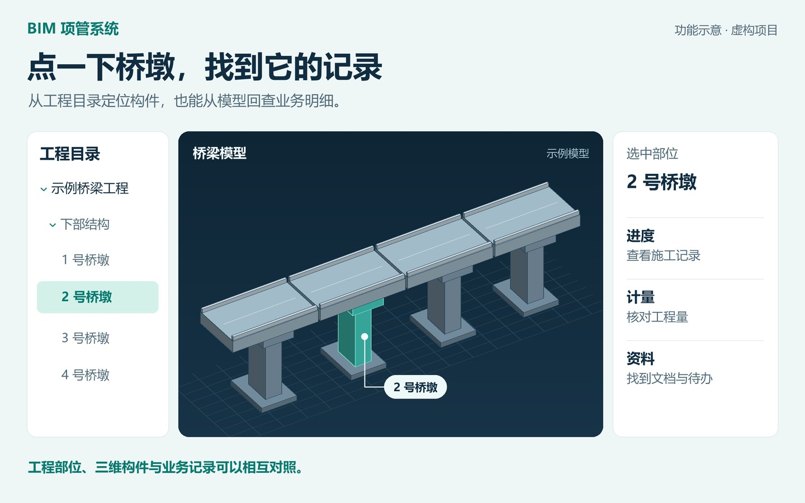
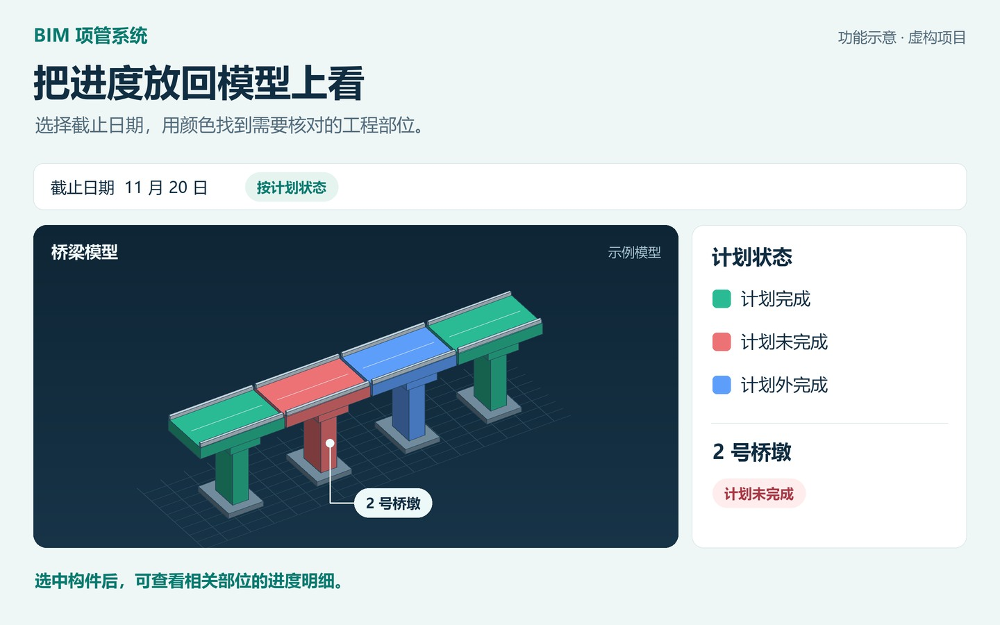
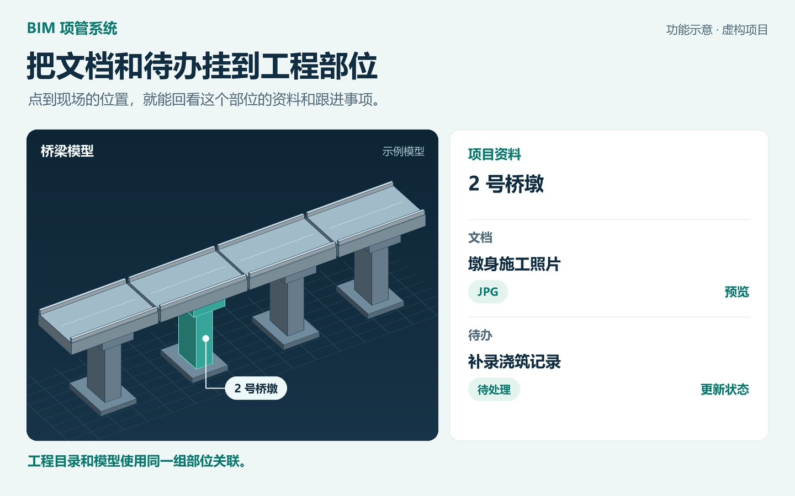

“这座桥的 2 号墩做到哪了？”要回答这个问题，通常得先在图纸或模型上找到桥墩，再翻进度记录。要是还想确认这一段的工程量、用料或施工照片，就得接着找对应的表和文件。

我做的 **BIM 项管系统**，想把这几次查找接起来。你在三维模型上点一下桥墩，就能顺着它找到对应的工程部位和业务记录。你也可以先在工程目录里找到一个部位，再让模型标出它的位置。

这里的 BIM 可以先理解成一份能点开看的工程模型，墩、梁和桥面都是可以分别选择的构件。“项管”就是项目管理。对要查进度、核对工程量或整理资料的项目人员来说，模型和业务记录得能指向同一处工程，这是我在这个项目里重点处理的地方。

*配图根据系统功能绘制，桥梁、部位和记录均为演示示例。*

## 从一段桥墩找到它的记录

还是拿 2 号墩举例。工程目录按单位工程、分部、分项逐层展开，一个部位可能对应好几个三维构件。系统有独立的模型绑定页面，项目人员选好工程部位和对应构件，再确认保存这层关系。

平时查询时，选左边的“2 号墩”，模型会把关联构件标出来。在模型上直接点桥墩，系统也能展开对应的目录分支，并打开当前业务页面的明细。比如在进度页看到的是进度记录，在计量页则可以查对应的工程量明细。

这部分做起来，最费心的地方之一是让两种入口查到的结果一致。一次选择可能碰到父、子两级部位都有关联的情况。页面要把相关部位都标出来，展示明细时又得避免把已经包含的记录列两遍。图上点亮一个桥墩之后，项目人员还要知道它对应的是哪一笔记录。

## 看进度时，先找到值得追问的地方

进度页面可以选一个截止日期，对照计划看看实际做到哪一步。计算完成后，系统可以按完成比例在模型上着色，也可以切换到状态视图，查看计划完成、计划未完成和计划外完成的部位。

比如开进度会时，大家可以先从颜色里找到需要讨论的桥墩或梁段，再点开进度明细核对。计算需要时间时，页面会显示当前阶段。切换日期或模型后，也要确保屏幕上的结果对应这一次选择。

首页还汇总了合同、产值、进度和物资等指标。想先了解项目整体情况，可以从首页看起。想确认某一个部位，就到计划、进度、计量、物资、变更或分包等业务页面继续查。

## 把资料和待办放到对应部位

过了几天还要回看 2 号墩的施工照片，或者接手同事留下的待办，该从哪里找？我希望只要知道是哪一处，就有办法把资料找回来。

项目页可以把文档和待办挂在具体工程部位上。选中目录节点可以查，从模型里点关联构件也能回查。比如在此处预览一份施工照片，再看有没有需要更新状态的待办。

模型本身也会更新。新版本上传后需要转换成浏览器能打开的格式。只要已有可用版本，新版还在转换或转换失败时，系统就会继续显示上一份成功转换的模型。这样有人更新模型时，其他人还能继续查现有资料。

## 也可以在模型旁边问一句

熟悉系统的人会直接进页面查。刚接触的人可能更愿意问：“这个月的进度怎么样？”或者“刚选中的构件关联了哪些业务记录？”我想让这两种方式查到同一份项目数据。

项目里接入了侧边的项目助手，能在当前项目和权限范围内查询业务信息，部分操作可以把查到的构件在模型里高亮。独立的助手版本也实现了根据查询结果生成表格文件和图表的功能，实际可用范围要结合部署环境中的模型和权限配置验证。

我更看重的是提问之后的那一步。助手指出了一个部位，使用者还能在图上找到它，打开对应记录核对。这样，开会时聊的还是大家都能看到的同一处工程。

## 我在这个项目里最在意的事

做这个项目时，我发现自己慢慢把注意力放到了几个小问题上。点模型和点目录查到的是不是同一个部位？切换日期以后，屏幕上的数字跟着变了吗？项目更新了模型，之前整理好的资料还能找到吗？

这些事情在演示里可能一晃就过去了，平时开会、核对和交接却绕不开。以后再有人问“2 号墩做到哪了”，我希望打开系统的人能在同一个地方找到桥墩、看到记录，再决定接下来该跟进什么。

给开发读者的一点补充

前端使用 Vue 3、Pinia 和 BIM 浏览引擎，后端基于 Java 和 Spring MVC。工程目录使用 WBS，也就是把工程逐层拆成可管理的部位。后端按项目和模型保存部位与构件的绑定，多个业务页面复用这层关系，在目录和模型之间做双向查询。模型转换由独立服务执行，后端管理转换状态和可展示版本。助手部分包含 Spring AI 业务查询和独立的 AgentScope 对话实现。

