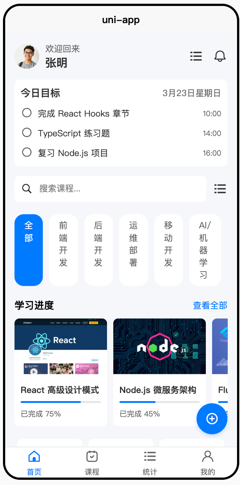
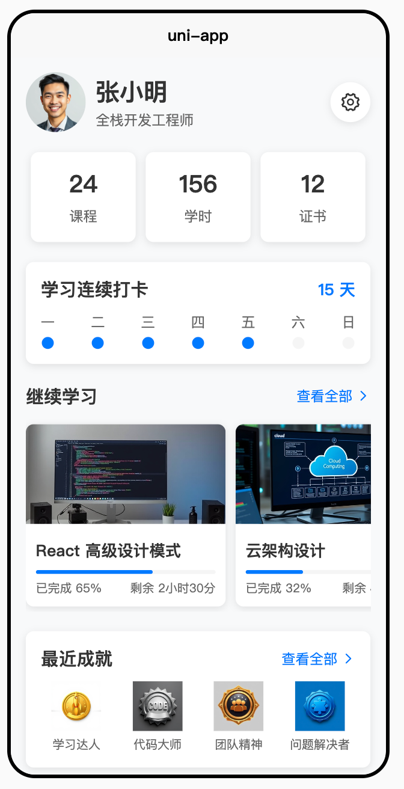
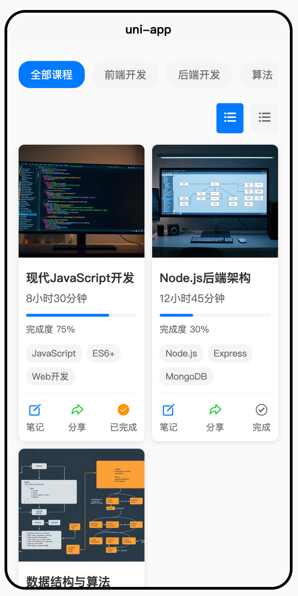
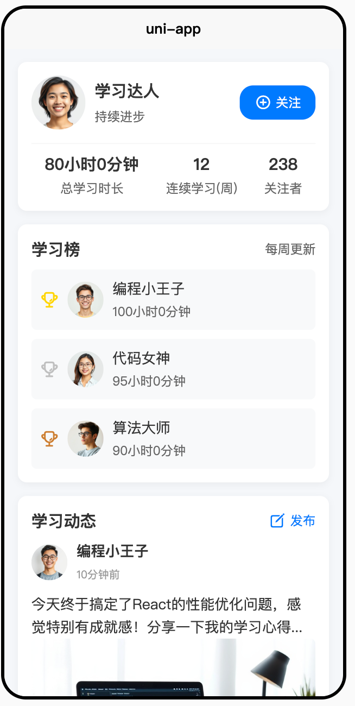
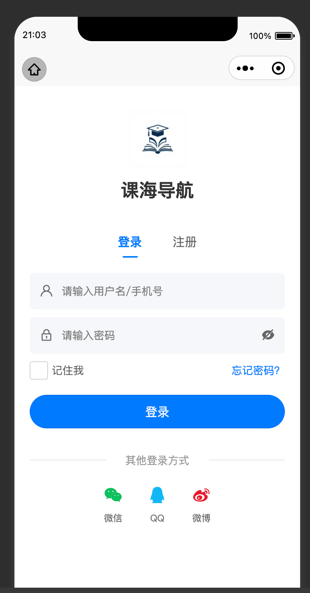
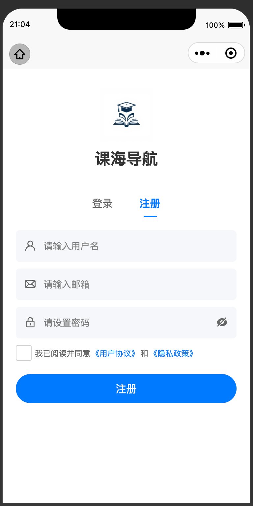

看过一门课，隔一阵子再打开，常会碰到两个问题。上次学到哪儿了？当时有哪些内容值得复习？我做课海导航，是想给这些学习过程留一份记录。

## 我希望回看时能找到什么

如果只记学习时长，过一段时间很难想起这几个小时花在了哪门课上。课海导航用 uni-app 和 Node.js 把课程进度、学习时长和知识记录放在一起。我希望回到某门课时，能从之前记下的内容继续往下学，也知道哪些课程只是开了个头。

它和我做的工程软件有一个相似之处。工程人员从一个部位查进度和资料，我从一门课找回进度和知识。两种场景的检查方法也相似。先挑一条之前记过的内容，再看能不能从自己记得的入口把它找回来。

## 项目界面
<figure style="width:60%">

</figure>
<figure style="width:60%">

</figure>
<figure style="width:60%">

</figure>
<figure style="width:60%">

</figure>
<figure style="width:60%">

</figure>
<figure style="width:60%">

</figure>
